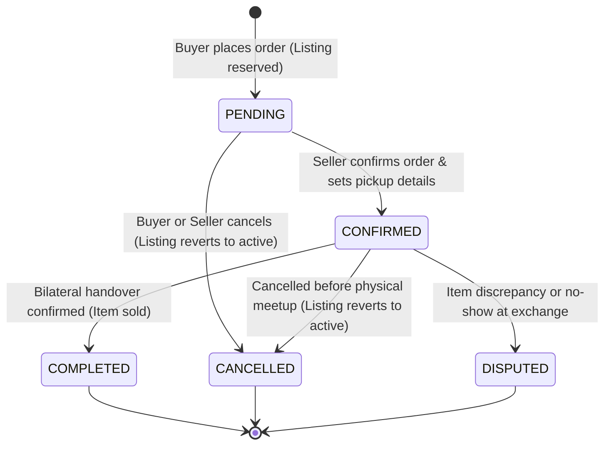

# ThriftSync — Buy & Campus Checkout Lifecycle Flow

## 1. Overview & Purpose
ThriftSync facilitates direct campus peer-to-peer commerce for student textbooks, clothing, electronics, and dorm living supplies.

As mandated by ThriftSync Core Rules (`AGENTS.md`):
1. **Inventory Concurrency Protection**: Outright purchases require atomic reservation of inventory (`status: 'active' -> 'reserved'`), preventing competing buyers, renters, or swap proposals from double-booking or double-purchasing the same item.
2. **Transparent Payment & Verification**: In accordance with the non-negotiable rule *"Verify payment status before reporting a successful payment. Do not represent demo data or mock integrations as production functionality"*, payment verification is conducted bilaterally upon physical safe-exchange handover or designated campus escrow.
3. **Bilateral Handover Verification**: Both buyer (confirming receipt and payment transfer) and seller (confirming receipt of payment and item delivery) must independently verify the physical handover.
4. **Resilience & Automatic Recovery**: If an order is cancelled or expires prior to bilateral completion, the underlying inventory atomically unlocks back to `status: 'active'`.

---

## 2. State Machine



---

## 3. Detailed Lifecycle Transitions

| Current State | Trigger / Action | Actor | Next State | Listing Status | Payment Status | Notes |
|---|---|---|---|---|---|---|
| *None* | `createOrder` | Buyer | `PENDING` | `reserved` | `PENDING` | Atomically locks listing (`status: 'active' -> 'reserved'`). Rejects if already booked. |
| `PENDING` | `confirmOrder` | Seller | `CONFIRMED` | `reserved` | `PENDING` | Seller accepts meetup spot & schedule |
| `PENDING` | `cancelOrder` | Buyer / Seller | `CANCELLED` | `active` | `CANCELLED` | Atomically reverts listing to `active` |
| `CONFIRMED` | `confirmHandover` (1 of 2) | Buyer or Seller | `CONFIRMED` | `reserved` | `PENDING` | Records single handover flag (`buyerConfirmed` or `sellerConfirmed`) |
| `CONFIRMED` | `confirmHandover` (2 of 2) | Second Party | `COMPLETED` | `sold` | `VERIFIED_UPON_HANDOVER` | Bilateral handover verified. Item permanently marked `sold`. |
| `CONFIRMED` | `cancelOrder` | Either Party | `CANCELLED` | `active` | `CANCELLED` | Reverts listing to `active` |
| `CONFIRMED` | `raiseDispute` | Either Party | `DISPUTED` | `reserved` | `PENDING` | Escalated for campus mediation |

---

## 4. Concurrency & Race Condition Prevention

To prevent race conditions where two students simultaneously click "Buy" on the last textbook or an item is rented while being purchased:

```javascript
const reservedListing = await Listing.findOneAndUpdate(
  { _id: listingId, status: 'active' },
  { status: 'reserved' },
  { new: true }
);

if (!reservedListing) {
  const error = new Error('This item is no longer available for purchase');
  error.statusCode = 409;
  throw error;
}
```

This atomic MongoDB operation guarantees that only one transaction can acquire the lock on an active listing.
