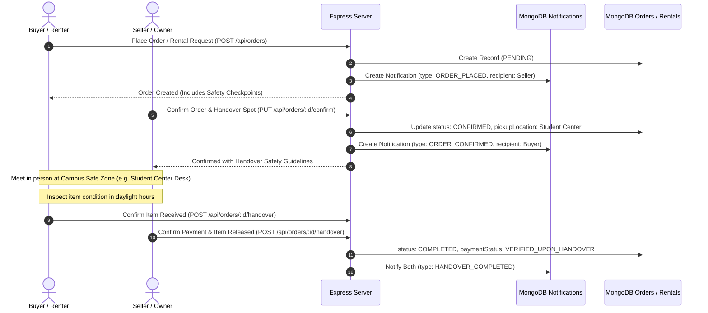

# ThriftSync — Campus Safety, Handover Coordination & Notification Flow

## 1. Overview
ThriftSync is built for local campus communities. To ensure zero fraud and student physical security, transactions must follow the verified campus handover protocol. The system pairs safe physical handover checkpoints with real-time peer notification updates and mutual in-app confirmation.

---

## 2. Handover Protocol & Notification Architecture

---

## 3. Verified Safe Campus Handover Checkpoints

1. **Campus Student Center**: Main Information Desk (1st Floor Lobby, Mon–Sun: 7:00 AM – 11:00 PM).
2. **University Main Library**: Circulation & Reserves Desk (Entrance Floor, Mon–Sun: 8:00 AM – Midnight).
3. **Dining Commons Atrium**: Central Atrium Seating Area (Daily: 7:30 AM – 9:00 PM).
4. **Residential Quad Welcome Desk**: Quad Welcome Desk & Mail Room (Daily: 9:00 AM – 10:00 PM).

---

## 4. Security & Privacy Non-Negotiables

- **Zero Exposure of Private Living Spaces**: In accordance with `AGENTS.md` ("Never expose passwords, tokens, secrets or private pickup information"), dorm room numbers, personal residential addresses, and private schedules are forbidden from being stored or exposed.
- **Bilateral In-App Confirmation**: Handover requires confirmation from both student participants before orders, rentals, or deposits are completed.
- **Notification Rate & Privacy**: Notifications are strictly isolated to the authenticated recipient student (`recipient === req.user._id`).
