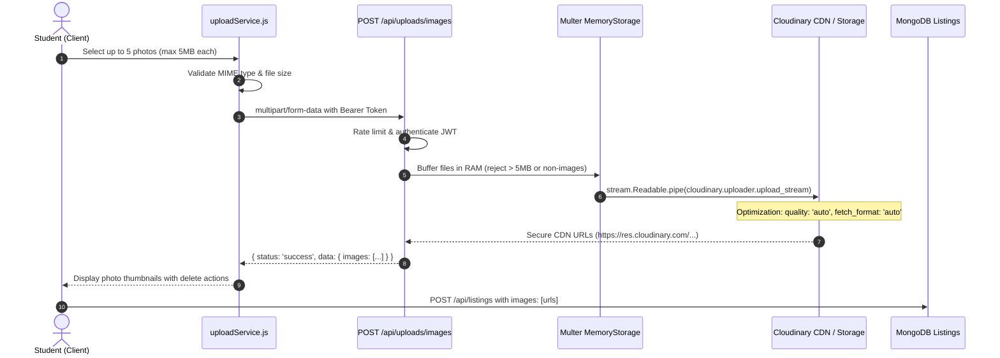

# ThriftSync — Cloudinary Image Upload & Storage Pipeline

## 1. Overview
The ThriftSync Image Upload Pipeline enables students to upload real photos of their pre-owned textbooks, fashion items, electronics, and dorm gear without saving orphaned files to the server's local filesystem. Images are validated client-side, streamed through an Express memory buffer, and delivered securely to Cloudinary with automatic optimization.

---

## 2. Architecture & Data Flow

---

## 3. Security & Reliability Controls

1. **In-Memory Buffering (`multer.memoryStorage`)**: Files are never written to disk as temporary files, eliminating directory traversal vulnerabilities and orphaned file accumulation on Windows host servers.
2. **File Size Hard Limits**: 5MB per image, strictly enforced by `multer({ limits: { fileSize: 5 * 1024 * 1024 } })`.
3. **MIME Verification**: Restricts uploads strictly to `image/jpeg`, `image/png`, `image/webp`, and `image/gif`. Executables, scripts, HTML, and arbitrary binary payloads are rejected with HTTP 400.
4. **Cloudinary Asset Optimization**: All uploaded images are delivered via Cloudinary's global CDN using `format: 'auto'` (WebP/AVIF depending on browser support) and `quality: 'auto'`.
5. **Offline / Development Fallback**: When Cloudinary credentials are not configured (e.g. offline local development or unit test runners), the server falls back to safe base64 data URIs so feature workflows remain fully functional without external network dependencies.
6. **Rate Limiting**: Protected by `creationLimiter` (50 upload operations per 15-minute window per IP) to mitigate denial-of-service and storage exhaustion.
