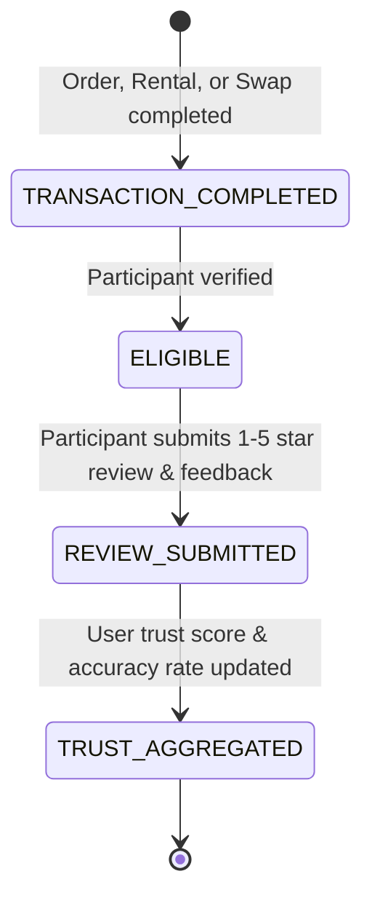

# ThriftSync — Verified Peer Reviews & Trust Flow

## 1. Overview & Purpose
ThriftSync is built on mutual student accountability. Trust is established through authentic, verified peer reviews following completed campus transactions (outright purchases, semester rentals, or circular swaps).

As mandated by ThriftSync Core Rules (`AGENTS.md`):
1. **Zero Fabrication**: *"Do not invent products, sellers, testimonials, reviews, prices, statistics or environmental impact claims."*
2. **Verified Transaction Requirement**: Reviews can ONLY be submitted by verified participants in a `COMPLETED` order, rental, or swap.
3. **Duplicate Prevention**: A student may submit at most one review per completed transaction.
4. **Community Trust Metrics**: Beyond simple 1–5 star ratings, reviews track item condition accuracy and punctuality at campus safe exchange points.

---

## 2. Peer Review State Machine & Lifecycle

---

## 3. Trust Metric Aggregations

When viewing a student's campus profile or listing:
- **Average Rating**: $\frac{\sum \text{ratings}}{\text{total reviews}}$ (displayed to 1 decimal place, e.g. 4.9 ★).
- **Verified Exchanges Count**: Total completed peer reviews.
- **Item Condition Accuracy**: Percentage of reviews where `criteria.itemConditionAsDescribed === true`.
- **Campus Punctuality**: Percentage of reviews where `criteria.punctualHandover === true`.
