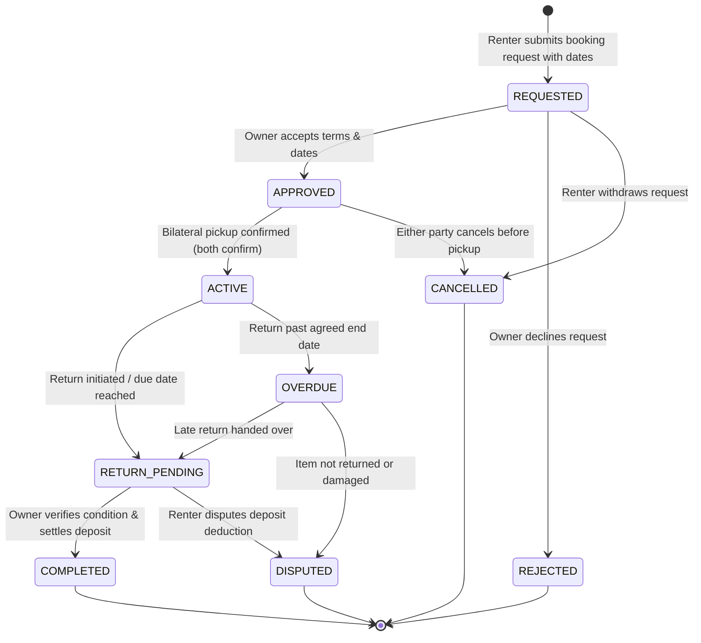

# ThriftSync — Rental & Return Lifecycle Flow

## 1. Overview & Purpose
ThriftSync facilitates campus-based item sharing and rentals (textbooks, lab equipment, graphing calculators, winter coats, formal attire, appliances) among verified students.

As mandated by the ThriftSync Core Rules (`AGENTS.md`):
1. **Separation of Accounting**: Rental charges (`rentalFee`) and refundable security deposits (`depositAmount`) must be tracked independently.
2. **Inventory Protection**: An item cannot be rented if it is already reserved or rented for overlapping dates, nor can a rented item be purchased or swapped.
3. **Bilateral Handover & Inspection**: Both renter and owner must independently verify and confirm physical handover at designated on-campus safe exchange zones.
4. **Deposit Settlement**: Return condition inspection governs whether the security deposit is refunded in full, partially forfeited with an itemized damage report, or fully forfeited.

---

## 2. State Machine

---

## 3. Detailed Lifecycle Transitions

| Current State | Trigger / Action | Actor | Next State | Listing Status | Deposit Status | Notes |
|---|---|---|---|---|---|---|
| *None* | `createRentalRequest` | Renter | `REQUESTED` | `active` | `HELD` | Validates date window, no overlap, renter != owner |
| `REQUESTED` | `decision: 'REJECT'` | Owner | `REJECTED` | `active` | `REFUNDED` | Reason required |
| `REQUESTED` | `decision: 'APPROVE'` | Owner | `APPROVED` | `active` | `HELD` | Listing ready for pickup handover |
| `REQUESTED` | `cancelRentalRequest` | Renter | `CANCELLED` | `active` | `REFUNDED` | Cancelled before approval |
| `APPROVED` | `confirmPickup` (1 of 2) | Renter or Owner | `APPROVED` | `active` | `HELD` | Records single handover flag (`pickupConfirmedBy...`) |
| `APPROVED` | `confirmPickup` (2 of 2) | Second Party | `ACTIVE` | `rented` | `HELD` | Bilateral pickup verified. Item locked from marketplace. |
| `APPROVED` | `cancelRentalRequest` | Either Party | `CANCELLED` | `active` | `REFUNDED` | Cancelled before physical handover |
| `ACTIVE` | `initiateReturn` | Renter | `RETURN_PENDING` | `rented` | `HELD` | Renter signals return handover readiness |
| `RETURN_PENDING` | `confirmReturn` (Full Refund) | Owner | `COMPLETED` | `active` | `REFUNDED` | Inspection: item in agreed condition |
| `RETURN_PENDING` | `confirmReturn` (Partial Deduction) | Owner | `COMPLETED` | `active` | `FORFEITED_PARTIAL` | Itemized damage note & deduction specified |
| `RETURN_PENDING` | `confirmReturn` (Full Forfeiture) | Owner | `COMPLETED` | `active` | `FORFEITED_FULL` | Severe damage or missing parts |
| `RETURN_PENDING` / `OVERDUE` | `raiseDispute` | Either Party | `DISPUTED` | `rented` | `HELD` | Escalated for campus mediator / admin resolution |

---

## 4. Date Overlap & Concurrency Safeguards

To prevent double bookings, the system queries for overlapping bookings on the same listing:

$$\text{Overlap Condition} \iff \text{existingStartDate} < \text{newEndDate} \;\land\; \text{existingEndDate} > \text{newStartDate}$$

Only rentals in non-terminal states (`['REQUESTED', 'APPROVED', 'ACTIVE', 'RETURN_PENDING', 'OVERDUE']`) are checked. Any attempt to request a conflicting window is rejected with a `409 Conflict` HTTP status code.

Furthermore, when a rental transitions to `ACTIVE`, the underlying `Listing` record is atomically updated to `status: 'rented'`, removing it from active marketplace queries.

---

## 5. Security Deposit Accounting

The deposit lifecycle guarantees transparent accounting:
- **`HELD`**: Initial state upon booking request. Deposit is earmarked for the duration of the rental.
- **`REFUNDED`**: Full deposit returned after successful return inspection without damage.
- **`FORFEITED_PARTIAL`**: Portion deducted for repairs or cleaning; remainder refunded to renter.
- **`FORFEITED_FULL`**: 100% of deposit retained by owner due to item destruction or loss.

All deductions require an explicit `damageReport`:
- `hasDamage`: Boolean
- `description`: String (minimum 10 characters)
- `deductionAmount`: Number (cannot exceed `depositAmount`)
